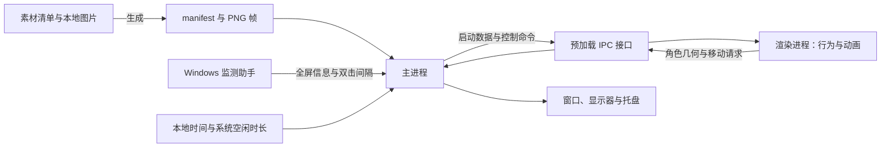

# 行为与窗口设计

糖猫的运行围绕三个问题展开：当前做什么、画面如何随时间推进、角色如何落在桌面的正确位置。本文解释这些机制，并集中记录调度、交互和运动参数，供修改行为与验收时使用。

距离采用系统逻辑像素 DIP，速度采用 DIP/s。DIP 是经过显示缩放折算的桌面坐标，与显示器物理像素分开计算。

## 进程如何协作

主进程管理窗口、显示器、托盘和持久设置，渲染进程管理行为状态、图片帧和计时。预加载层提供两者之间的桌宠接口，纯算法负责随机抽取、计时和运动计算。

这个分工让画面直接使用浏览器的图片、Canvas 和动画时钟，系统操作则由 Electron 主进程完成。实现集中在 `src/main.js`、`src/preload.js`、`src/renderer.js`，纯算法位于 `src/core.js`。

启动时，主进程先取得单实例锁，再读取 manifest 与设置，创建隐藏的 `960 × 900` 透明窗口。Windows 助手提供首份系统双击间隔后，主进程向渲染进程返回启动数据。渲染进程预解码移动素材、选择日常、设置首图并报告几何；主进程据此把角色碰撞箱放到主显示器可用区域右下角，距右侧 14 DIP、底部 10 DIP。显示条件允许时窗口出现，首图载入后报告就绪。

窗口尺寸容纳角色完整画布和上方气泡，实际形状随内容调整。重复启动时，新进程退出，现有窗口与行为继续。退出应用时一并结束监测助手。

## 行为状态与时间

渲染进程用互斥状态表示日常、悬停、静态动作、GIF 动作、移动、拖拽、投掷、落地、玩耍和隐藏。新行为接管时，清理被替代行为的计时、动画和移动；悬停等需要恢复的过程保存对应等待。

常规循环是“日常等待 → 抽取普通动作或移动 → 新日常”。悬停保留原日常及剩余等待；用户触发动作或移动则结束旧等待，完成后开始完整的新等待。

暂停活动、鼠标穿透与全屏隐藏是独立控制条件，各自作用于不同环节：

| 条件 | 对运行状态的作用 |
|---|---|
| 手动暂停 | 暂停日常倒计时；正在执行的行为继续，手动行为结束后的新等待保持暂停 |
| 鼠标穿透 | 清除待确认点击、退出悬停，关闭角色输入；自动计时沿用当前暂停状态，玩耍仍采样全局光标 |
| 手动藏起 | 结束当前行为并停止全部行为计时；叫回时重建日常、清空最近记录、恢复初始方向 |
| 全屏隐藏 | 保存并暂停日常、动作、帧、移动、投掷、落地及气泡进度；拖拽和玩耍结束，恢复时进入新日常 |

### 暂停后怎样接着播放

可暂停计时器保存剩余时长：暂停时减去已过时间，恢复时重新安排剩余部分。GIF 在生成阶段拆成原尺寸 PNG 帧，每帧时长来自源 GIF，下限为 20 ms；运行时记录当前帧、剩余帧时长、已完成循环和目标循环数。

静态普通动作均匀随机持续 2～4 秒。GIF 从总时长落在 3～6 秒的整数循环数中等概率抽取；单循环超过 6 秒时完整播放一次。自主移动使用 3～8 秒的完整循环区间。设循环长度为 `T` 毫秒，则有效移动循环数为 `ceil(3000/T)` 到 `floor(8000/T)`；例如 260 ms 的动画可选 12～30 次。动画完成事件负责结束行为，手动命令可以提前接管。

图片解码和跨进程移动都有异步结果。每段执行持有自己的标记，行为替换使旧执行失效；回调核对所属行为与暂停状态，再决定何时继续推进。全屏暂停还清空移动的上次时间戳，恢复第一帧重新建立基准，隐藏时间因此不会累积为位移。

## 日常调度与随机选择

性格决定日常等待和下一次自动行为类型。等待时长在区间内均匀抽取：

| 性格 | 日常等待 | 普通动作 | 自主移动 |
|---|---:|---:|---:|
| 安静 `quiet` | 35～50 秒 | 85% | 15% |
| 默认 `default` | 20～30 秒 | 66% | 34% |
| 活泼 `active` | 10～18 秒 | 55% | 45% |

日常或悬停期间切换性格会重新抽取完整等待，其他行为保持当前进度。日常从 `standing`、`working`、`obedient`、`sleeping`、`sitting` 中抽取，悬停图片从选中日常的候选中等概率抽取。具体图片角色由素材清单定义。

### 环境如何改变权重

主进程每秒读取一次系统空闲时长。最近 10 个样本中至少 8 个的空闲时长不超过 2 秒时，判为高活动；高活动结束后保留工作倾向 30 秒。21:00 至次日 08:00 为夜间，空闲达到 10 分钟为长期空闲。

工作倾向优先于夜间和空闲。启用环境感知后，选中的偏好组内每个候选权重为 3，其余为 1：

| 偏好组 | 日常 | 自动普通动作 |
|---|---|---|
| 工作 | `working` | `iv-drip`、`writing`、`read-book` |
| 睡觉 | `sleeping` | `sleep-after-meal`、`prone-2`、`sleep`、`recliner` |

夜间与空闲同时成立时仍使用权重 3。无偏好或关闭环境感知时各候选等权。五个日常中只有一个工作状态，因此工作倾向下该状态的概率为 `3 / (3 + 1 + 1 + 1 + 1) = 3/7`。偏好改变的是抽取概率。

### 普通动作怎样避免连续重复

最近记录保存已开始播放的五个普通动作或落地反馈，即使中途结束也保留。日常、悬停、拖拽和自主移动拥有各自的选择流程。

抽取先确定候选池，再排除最近记录中的 ID，最后应用权重。小池被全部排除时，从最早记录开始逐个释放限制，直到出现候选；新动作开始后仍保留最近五条。

| 触发方式 | 候选与单素材权重 |
|---|---|
| 自动普通动作 | 普通动作池，基础权重 1，再应用环境偏好 |
| 单击 | 普通动作池，静态权重 2、GIF 权重 1 |
| 双击 | GIF 普通动作池，等权 |
| 右键随机动作 | 普通动作池，等权 |

权重属于单个素材，整体静态/GIF 概率还取决于过滤后的候选数量。环境偏好只作用于日常和自动普通动作。

普通动作等概率选择对应主题的四条短句，气泡跟随动作显示并在结束前淡出。特殊状态使用独立的展示语义：例如 `flying` 作为普通动作有气泡，作为投掷飞行则只显示角色。日常、悬停、拖拽、移动、玩耍与落地同样只显示角色。完整启动另从四条开场白中等概率选择一条，显示约 3.5 秒；新行为可以提前接管。

## 鼠标命中与点击时序

窗口形状由矩形区域组合而成，区域内部仍可能含透明像素。因此收到鼠标事件后，渲染进程通过 Canvas 读取当前图片 alpha，以 8 为阈值确认角色命中。

悬停只从日常进入。为保持换图前后命中的连续性，它同时保留原日常和当前悬停轮廓，附加 4 DIP 容差。普通日常和悬停每 80 ms 查询系统光标，连续离开有效区域 120 ms 后退出；进入时用约 150 ms 上移 4 DIP，退出时回落。每次进入独立抽取悬停图片，鼠标留在区域内时保持本次选择。

单击与双击共用 Windows 的系统判定间隔，输入按以下顺序处理：

1. 第一次释放时，确认命中及状态，安排待确认单击。
2. 系统识别第二次按下时，立即取消单击；随后 `dblclick` 触发 GIF。
3. 等待到期的单击再次检查当前状态，再开始普通动作。

调度与执行时的两次判断分别处理“是否接受输入”和“等待期间状态是否变化”。日常、悬停、静态动作、GIF 和自主移动接受点击；投掷、落地和玩耍保持各自输入规则。拖拽、右键行为命令、穿透和藏起会清除待确认单击，拖拽释放后 400 ms 抑制点击事件。

## 几何、运动与投掷

画面使用三种几何表示：完整图片画布用于绘制与镜像；当前帧可见边界加 3 DIP 余量形成碰撞箱；角色、悬停保留区域和气泡区域共同组成原生窗口形状。气泡进入显示范围，运动边界仍只依据角色。

渲染进程应用 manifest 的显示倍率与用户档位。帧、倍率、镜像或悬停偏移变化后，碰撞和命中几何随画面更新。主进程将角色碰撞箱限制在显示器 `workArea` 中，以留出任务栏；切换大素材时也据此校正位置。

### 按完整动画周期移动

| 移动 | 动画组成 | 速度 |
|---|---|---:|
| 迈步 `walk` | `walk-step`、`walk-leg-lift` 各 250 ms | 50 DIP/s |
| 跳跳 `jump` | `movement-jump` GIF，按源帧时长生成 | 80 DIP/s |
| 跑 `run` | `run-1`、`run-2` 各 130 ms | 120 DIP/s |

三种移动等概率，水平/垂直轴与轴上两个初始方向分别等概率。五份移动专用素材独立于普通动作池；普通动作 `jump` 与移动 GIF `movement-jump` 使用不同素材。碰壁只改变方向，动画完成选定循环后结束。

渲染进程按速度与时间计算位移，主进程应用到窗口并返回触边结果。以 50 DIP/s 移动时，16 ms 的位移只有 0.8 DIP；运行时累计小数余量再发送整数窗口位移，以保留平均速度。单帧积分时长上限为 100 ms。

水平移动朝向行进方向，左右碰壁反向并镜像；垂直碰壁只反向。朝向跨普通行为保留。自动活动留在当前显示器，拖拽按光标所在显示器更新归属。

### 从拖拽速度进入投掷

按下后位移超过 5 DIP 进入拖拽，显示 `handstand`，结束旧行为与气泡。拖到左右边缘时翻转一次，离开该边缘后才再次接受翻转。松手前约 120 ms 的轨迹用于估算释放速度：低于 900 DIP/s 正常放下，否则进入投掷；初速最高 3000 DIP/s。

投掷使用 `flying`，按二维释放向量运动，并用水平、垂直镜像匹配象限。速度每秒降低 700 DIP/s；碰壁只反转命中轴，并将该轴速度乘以 0.7，另一轴保持。速度低于 60 DIP/s 后进入落地反馈。

落地从 `rainbow-vomit`、`fall-over`、`awkward`、`prone-2`、`prone-3`、`vomit` 中按最近记录规则等概率抽取，显示 2～4 秒。飞行期间角色鼠标操作关闭；落地接受右键行为命令，单击、双击与拖拽保持落地状态。

## 玩耍会话

玩耍有独立的 90 秒会话时钟，每 50 ms 采样全局光标。反应按以下优先级处理，结束后回到会话内等待：

| 优先级 | 反应 | 条件及推进方式 |
|---:|---|---|
| 1 | 拖拽 | 用户直接拖动角色 |
| 2 | 绕圈疑惑 | 距离 80～260 DIP，3 秒累计绕行 300°；显示 `puzzled` 2 秒，冷却 6 秒 |
| 3 | 拍鼠标 | 距离 100 DIP 内，光标速度不超过 180 DIP/s；等概率显示 `reach` 或 `greeting` 1.2 秒，冷却 4 秒 |
| 4 | 追逐 | 每隔随机 10～16 秒尝试，以 120 DIP/s 追逐 2～4 秒，进入 80 DIP 范围提前结束 |
| 5 | 靠近 | 距离超过 260 DIP 时以迈步动画、50 DIP/s 靠近，到 160 DIP 停止 |
| 6 | 朝向 | 没有更高优先级反应时面向鼠标 |

拍鼠标的 `greeting` 额外水平翻转，使手朝向光标。正常拖放保留会话，放下时会话已到期则进入日常；快速释放结束会话并转入投掷。手动暂停与穿透保持会话时钟运行。当前显示器全屏时开始入口禁用，进行中的会话在进入全屏时结束。

## 全屏监测与显示器身份

Windows 助手枚举可见顶层窗口，比较外框、客户区与显示器边界。覆盖判断容许 3 个物理像素的边缘误差，外框宽高最多超出对应显示器 32 个物理像素；普通最大化窗口只有客户区覆盖整屏时才满足条件。桌面、任务栏、开始菜单等系统表面从候选中排除，失去焦点但仍覆盖屏幕的窗口继续参与判断。

每轮监测完成后等待 750 ms。助手采用每显示器 DPI 感知模式，输出 Win32 物理坐标；主进程把监测矩形中心通过 `screen.screenToDipPoint` 转成 DIP，再定位 Electron 显示器。此转换将系统检测结果对应到桌宠使用的显示器身份。

每块屏幕独立记录稳定状态，连续三次全屏样本接受进入，连续两次非全屏样本接受退出。按屏保存计数使另一屏的切换保持本屏确认过程。桌宠只读取当前显示器的结果，并据此向渲染进程发送暂停或恢复命令。隐藏期间迟到的光标回复维持暂停状态。

监测助手在同一报告中提供系统双击间隔。系统接入位于 `scripts/fullscreen-monitor.ps1` 与 `src/main.js`。

## 运行资源与持久设置

开发时直接读取生成目录。构建时，页面、样式、渲染脚本、运行 manifest、PNG 帧与托盘图标写入 AES-256-GCM 资源包。主进程验证并解密到内存，通过同源的 `tangmao-resource://app/` 协议响应渲染请求；这让行为代码沿用统一的资源路径。

ASAR 装入 `LICENSE`、`package.json`、构建后的主进程和预加载代码，以及 `assets/runtime.tpack`。运行 manifest 去掉源路径、源内容哈希、生成时间与统计字段；原 GIF 留在开发目录，应用和托盘图标由 `stand` 生成。外部全屏助手位于 `resources/fullscreen-monitor.ps1`，运行时核对构建时记录的摘要。

渲染进程使用上下文隔离与 sandbox，关闭 Node 集成。Electron Fuses 关闭 RunAsNode、Node 环境参数和调试参数，启用 ASAR 完整性与仅从 ASAR 加载应用。资源包负责认证与加密存放，应用携带解密能力，运行图像在内存中使用，Windows 图标嵌入 EXE。

主进程在 Electron `userData/settings.json` 中持久化 `personality` 与 `environmentAwareness`；首次值为 `default` 和 `true`，读取时校验这两个字段。设置文件缺失、损坏或字段无效时重建默认内容。窗口位置、大小、方向、暂停、穿透和行为进度属于本次运行，由启动与叫回流程建立。
