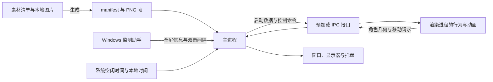

# 设计说明

糖猫的运行可以分成三个问题：决定当前行为，按时间推进画面，把可见角色放到桌面的正确位置。行为状态由渲染进程管理，窗口和系统状态由主进程管理，素材生成阶段提供二者使用的帧数据与几何信息。

距离和速度使用系统逻辑像素（DIP）；DIP 表示经过系统缩放折算后的桌面坐标，区别于显示器的物理像素。

## 从启动到第一帧

主进程取得单实例锁后，读取素材 manifest 与持久设置，开始采样环境状态，创建一个透明的 `960 × 900` 窗口。窗口先保持隐藏，容纳角色和上方气泡的完整画布。

Windows 监测助手提供系统双击间隔和全屏窗口信息。渲染进程请求启动数据时，主进程等待首份双击设置，再一起返回素材、窗口大小和当前运行设置。渲染进程预解码移动素材、选择日常状态，设置首张图片，并根据 manifest 报告角色几何。主进程在首次布局时把角色放到主显示器右下角；用户隐藏与全屏条件允许时显示窗口。首张图片载入完成后，渲染进程报告就绪。

这个分工让画面逻辑直接使用浏览器的图片、Canvas 和时钟能力，同时把窗口位置、系统光标和本地设置留在主进程。预加载接口只暴露桌宠需要的操作。对应实现集中在 `src/main.js`、`src/preload.js` 和 `src/renderer.js`。

## 行为状态与运行开关

渲染进程使用互斥的行为状态表达当前活动：日常、悬停、静态动作、GIF 动作、自主移动、拖拽、投掷、落地、玩耍及隐藏。切换行为时，先结束上一行为的计时、动画和移动，再建立新状态。

暂停、鼠标穿透和全屏隐藏是独立运行条件。它们作用于不同范围：手动暂停控制下一轮自动活动；穿透控制鼠标输入；全屏隐藏暂停当前进度。因此，暂停中的糖猫仍可以被点击，穿透中的糖猫仍可以自动移动。

一次普通活动的路径是：进入日常并设置倒计时，倒计时完成后抽取动作或移动，行为结束后进入新的日常。悬停暂时保留原日常及其剩余等待；用户触发新动作则结束旧等待，动作完成后开始完整的新等待。

玩耍保留独立的 90 秒会话计时，内部再切换靠近、拍鼠标、疑惑与追逐。普通拖放返回当前会话，快速释放结束会话并转入投掷。全屏切换结束玩耍或正在进行的拖拽，恢复时进入新日常。

### 一次点击如何接管行为

1. 输入先检查当前行为是否接受点击，并按图片透明度判断命中位置。
2. 第一次释放鼠标后，记录一个待确认单击，等待 Windows 双击间隔。
3. 系统识别第二次按下时取消待确认单击；最终 `dblclick` 选择 GIF 动作。
4. 单击到期时再次检查当前状态，再从普通动作池选择素材。
5. 开始动作，写入最近记录，播放图片或帧序列，并显示该主题的气泡。

延迟单击需要在调度时和执行时分别判断：调度判断决定这次输入是否被接受；执行判断决定等待期间发生的状态变化是否允许它继续。拖拽、右键行为命令、穿透或手动藏起会主动清除待确认单击。这是处理系统输入时序所需的状态约束。

## 时间、动画与异步结果

可暂停计时器保存的是剩余时长。暂停时从原时长中减去已过时间，恢复时重新安排剩余部分；取消则清空计时。这使“暂停后继续”和“开始一个新动作”具有不同语义。

GIF 在素材阶段拆成 PNG 帧，每帧记录显示时长。运行时按帧推进，同时保存当前帧、剩余帧时长、已完成循环和目标循环数。这样，全屏恢复后可以接着暂停的帧播放，自动结束也能落在完整循环末尾。迈步与跑动使用清单中的静态帧序列，采用相同的循环完成语义。

以 260 ms 的跳跳动画为例，3～8 秒移动允许 12～30 个完整循环。程序等概率抽取一个循环数，由动画完成事件结束移动；碰壁只改变方向，循环计数继续。

图片解码和跨进程移动都异步完成。每段动画或移动带有当前执行标记；行为被替换或暂停后，旧标记失效。异步结果返回时核对所属行为，再决定是否继续安排下一帧。这样，旧动作的解码结果或移动回复不会接管新动作。

全屏暂停还会清空移动的上次时间戳。恢复后的第一帧重新建立时间基准，隐藏的时长不会一次性转化为位移。基础计时与运动算法位于 `src/core.js`，动画推进位于 `src/renderer.js`。

## 抽取行为与环境偏好

随机行为先确定候选池，再排除最近开始过的五个普通动作或落地反馈，最后应用当前触发方式的权重。如果一个小池被全部排除，就从最早的记录开始释放候选。

单击对每个静态素材赋权 2、每个 GIF 赋权 1；双击只使用 GIF 池。权重属于单份素材，所以静态动作的整体概率还取决于候选数量。右键随机动作对每个候选赋相同权重。

自动行为由性格决定等待时间和动作/移动比例。环境感知进一步影响日常与自动动作：工作倾向优先，其次是夜间或空闲带来的睡觉倾向。目标组权重为 3，其余为 1。关闭环境感知后，候选恢复等权。

例如五个日常状态中只有 `working` 属于工作组。工作倾向生效时，总权重为 `3 + 1 + 1 + 1 + 1 = 7`，工作日常的概率是 `3/7`。权重会改变出现频率，当前画面仍由一次随机抽取决定。

主进程每秒读取系统空闲时间，在最近十次样本中累计活跃样本；本地时钟提供夜间判断。送往渲染进程的是这些条件的布尔状态，渲染进程据此选择素材。

## 可见角色、鼠标命中和窗口形状

透明图片有三种几何用途：

| 几何 | 表达什么 | 用在哪里 |
|---|---|---|
| 图片画布 | 完整 PNG/GIF 帧的尺寸 | 图像绘制、镜像与缩放 |
| 角色碰撞箱 | 当前帧不透明边界，加 3 DIP 余量 | 移动、拖拽、碰壁和任务栏避让 |
| 窗口形状 | 角色矩形区域、悬停保留区域及气泡区域的组合 | 原生窗口的显示范围 |

角色碰撞箱依据当前帧更新。气泡参与窗口形状，让文字可以显示在角色外；碰壁仍采用角色碰撞箱，气泡长度不会改变角色的移动边界。

鼠标命中再使用 Canvas 读取图片 alpha，阈值为 8。悬停增加 4 DIP 容差，并保留进入悬停前的日常轮廓，与当前悬停轮廓共同判断。轮廓改变时，鼠标因此可以留在原来触发的位置。连续离开 120 ms 才退出悬停，系统光标查询持续确认离开状态。

点击使用当前图片的像素命中。原生窗口形状由矩形区域组成，内部仍可能含透明像素，因此窗口收到事件后还要进行这一判断。

显示倍率等于素材 manifest 中的 `displayScale` 乘以用户大小档位。镜像时，碰撞箱的源坐标随完整画布翻转；悬停上移时，命中与碰撞几何随画面更新。原始图片、运行时几何和窗口坐标各有明确用途。

## 移动、投掷与显示器

渲染进程按速度和经过时间计算位移，主进程负责把位移应用到窗口，并返回是否碰到水平或垂直边界。主进程将角色碰撞箱限制在显示器的 `workArea` 内，因此任务栏占用的区域会留出来。

窗口位置使用整数坐标，而一帧位移常有小数。例如以 50 DIP/s 移动，16 ms 内只有 0.8 DIP。运行时把小数余量留到下一帧，累计到整数后再发送移动请求，保持低速移动的平均速度。每帧用于运动积分的时长上限为 100 ms。

水平碰壁反转移动方向并镜像角色；垂直碰壁只反转移动方向。用户拖拽时按光标所在显示器更新当前显示器，自动移动沿用当前显示器。

投掷由松手前 120 ms 内的轨迹估算二维速度，初速上限为 3000 DIP/s。每一步先计算运动，再按 700 DIP/s²减速；碰壁时将命中轴的速度反向并乘以 0.7，另一轴保持原值。速度低于 60 DIP/s 时转入落地反馈。飞行始终沿二维方向减速，轨迹由释放方向和边缘反射决定。

## 全屏监测与坐标换算

Windows 助手每轮枚举可见顶层窗口，比较窗口外框、客户区和显示器边界，排除桌面、任务栏、开始菜单等系统表面。覆盖判断允许 3 个物理像素的边缘误差，外框宽高最多超出对应显示器 32 个物理像素。判断依据覆盖范围，所以失去焦点但仍覆盖屏幕的全屏窗口也会被识别。每轮完成后等待 750 ms。

助手以每显示器 DPI 感知方式读取 Win32 物理坐标。主进程将返回的显示器矩形中心通过 `screen.screenToDipPoint` 转为 DIP，再定位 Electron 显示器。这一步把 Win32 检测结果对应到 Electron 使用的显示器身份。

每块显示器独立维护稳定状态：连续三次全屏样本接受“进入”，连续两次非全屏样本接受“退出”。最终只读取糖猫当前显示器的结果。把计数按显示器保存后，另一块屏幕上的变化就不会重置当前屏幕的确认过程。

全屏状态变化通过主进程命令暂停或恢复渲染进程。隐藏期间到达的光标查询结果保持当前状态。监测助手还在每轮报告 Windows 双击间隔，与全屏信息共用现有进程通信。系统接入部分位于 `scripts/fullscreen-monitor.ps1` 与 `src/main.js`。

## 素材清单与运行资源

`assets/catalog.json` 描述稳定的语义 ID 和用途。一个 ID 可以同时用于普通动作与特殊行为，例如 `flying` 既能播放普通动作，也用于投掷；两种触发方式由状态机赋予不同计时和气泡语义。

生成器读取清单、校验源文件、提取每帧边界与时长，并生成 manifest。输出中的文件名按内容哈希组织，角色身份仍由语义 ID 表达。显示倍率记录在 manifest，窗口运行时应用它；原始文件保持原尺寸。

开发模式读取本地生成文件。正式构建把页面、样式、渲染脚本、运行 manifest、所需 PNG 帧和托盘图标写入 AES-256-GCM 资源包。主进程验证并解密到内存，通过 `tangmao-resource://app/` 同源协议响应资源请求。

资源包负责内容认证与加密存放；ASAR 完整性和 Electron Fuses 约束应用加载方式。全屏助手作为外部脚本运行，主进程用构建时记录的摘要核对其内容。应用自带解密所需能力，运行中的图片会进入内存；Windows 应用图标嵌入 EXE。构建验证检查这些实际文件与加载约束。

## 保存设置的范围

主进程只将性格和环境感知写入 Electron `userData` 目录下的 `settings.json`，字段分别为 `personality` 和 `environmentAwareness`。首次启动写入默认值：`default` 与 `true`。读取时校验这两个字段，损坏或无效的设置会重建为默认内容。

窗口位置、缩放、暂停、穿透、方向、最近记录和当前行为属于一次运行。完整退出后重新启动，从主显示器右下角建立新现场。托盘叫回仍属于同一次运行，沿用大小、暂停和穿透设置，但重新选择日常并清空最近记录。
